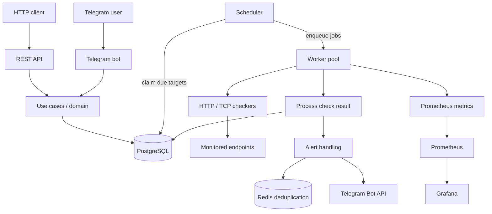

# Uptime Monitor

A backend service written in Go for monitoring the availability of HTTP and TCP endpoints. It runs scheduled checks, records response times and failures, tracks incidents, and sends notifications through Telegram.

This is an independently developed engineering project focused on Go concurrency, background processing, PostgreSQL, and observability.

> **Project status:** Local development / portfolio project. The current implementation is not intended for public internet deployment or production use without additional security and reliability improvements.

## Features

- **HTTP checks:** Compare the HTTP status code with an expected value and optionally check for text in the response body.
- **TCP checks:** Verify whether a TCP connection to a target can be established.
- **Scheduled execution:** Use a scheduler and a bounded worker pool to run checks concurrently.
- **Incident tracking:** Open an incident after three consecutive failed checks and close it when the target recovers.
- **Telegram bot:** Manage HTTP monitors and receive DOWN / UP notifications.
- **REST API:** Create, list, inspect, update, and delete monitors; retrieve check and incident history.
- **Observability:** Export Prometheus metrics, display them in Grafana, and write structured JSON logs.
- **History retention:** Periodically remove old check records (configured to retain 30 days).

## Tech stack

| Area | Technology |
| --- | --- |
| Backend | Go 1.26, `net/http`, `chi` |
| Database | PostgreSQL, `pgx` |
| Coordination and deduplication | PostgreSQL row locking, Redis |
| Notifications | Telegram Bot API |
| Metrics and dashboards | Prometheus, Grafana |
| Database migrations | Goose |
| Local environment | Docker, Docker Compose |

## Architecture

The project is organized as a **modular monolith**: the HTTP API, Telegram bot, scheduler, and workers run in one Go application, with shared domain and use-case logic.



**Implementation details:**

- A fixed number of worker goroutines consume jobs from a buffered Go channel.
- The scheduler claims due targets in PostgreSQL using `FOR UPDATE SKIP LOCKED` and advances their next scheduled check time.
- HTTP requests and TCP connection attempts have per-target timeouts.
- Check results and incident state transitions are handled by separate use cases.
- Redis `SETNX` provides a temporary claim to reduce duplicate alert processing; PostgreSQL also enforces a uniqueness constraint for incident/type pairs.

## Run locally

### Prerequisites

- Docker with Docker Compose
- A Telegram bot token created through [BotFather](https://t.me/BotFather)
- Go 1.26+ only if you want to build or run tests outside Docker

### 1. Configure environment variables

Copy the provided example file and edit the values:

```bash
cp .env.example .env
```

Set `TELEGRAM_BOT_TOKEN` and choose a local Grafana admin password in `.env`. Do not commit `.env` or share actual credentials.

The provided Docker Compose configuration uses **development-only PostgreSQL credentials**. Review them and the published ports before using the project outside a trusted local environment.

### 2. Start the application and dependencies

```bash
docker compose up --build -d
```

Compose starts PostgreSQL, applies Goose migrations, starts Redis and the Go service, and then starts Prometheus and Grafana.

Check container status and logs:

```bash
docker compose ps
docker compose logs -f uptime-monitor
```

### 3. Check service endpoints

```bash
curl http://localhost:8080/healthz
curl http://localhost:8080/readyz
```

Expected successful responses:

```json
{"status":"ok"}
```

```json
{"status":"ready"}
```

The readiness endpoint checks the PostgreSQL connection.

### Local services

| Service | URL |
| --- | --- |
| REST API and health endpoints | `http://localhost:8080` |
| Prometheus metrics | `http://localhost:8080/metrics` |
| Prometheus UI | `http://localhost:9090` |
| Grafana | `http://localhost:3000` |

Grafana uses the credentials configured in `.env`. The repository contains provisioning configuration and a Uptime Monitor dashboard under `monitoring/grafana/`.

To stop the stack:

```bash
docker compose down
```

This preserves named database and Grafana volumes. Use `docker compose down -v` **only if you deliberately want to delete local persisted data**.

## Telegram bot

After starting the stack, open your Telegram bot and send `/start`. This registers your Telegram account in the application's `users` table.

Example:

```text
/add https://example.com 60
/list
/status 1
/incidents 1
/pause 1
/resume 1
/remove 1
/help
```

`/add` creates an **HTTP** monitor. The optional second argument is the check interval in seconds (default: 60). TCP monitors can be created through the REST API.

## REST API

Base URL: `http://localhost:8080`

| Method | Endpoint | Purpose |
| --- | --- | --- |
| `POST` | `/api/v1/monitors` | Create a monitor |
| `GET` | `/api/v1/monitors?user_id=1` | List monitors for a user |
| `GET` | `/api/v1/monitors/{id}` | Get details, status, latest check, and uptime |
| `PATCH` | `/api/v1/monitors/{id}` | Update monitor settings |
| `DELETE` | `/api/v1/monitors/{id}` | Delete a monitor |
| `GET` | `/api/v1/monitors/{id}/checks?limit=50` | Get recent checks |
| `GET` | `/api/v1/monitors/{id}/incidents?limit=20` | Get recent incidents |

### Example: create an HTTP monitor

First send `/start` to your Telegram bot. To find the corresponding **internal application user ID** in your local database:

```bash
docker compose exec postgres psql -U postgres -d postgres -c 'SELECT id, telegram_id, username FROM users;'
```

Then replace `1` with that internal `users.id` value in this request:

```bash
curl -X POST http://localhost:8080/api/v1/monitors \
  -H 'Content-Type: application/json' \
  -d '{
    "user_id": 1,
    "kind": "http",
    "address": "https://example.com",
    "interval_seconds": 30,
    "timeout_seconds": 5,
    "expected_status": 200,
    "expected_body": ""
  }'
```

Retrieve monitors or the check history for a created monitor:

```bash
curl 'http://localhost:8080/api/v1/monitors?user_id=1'
curl 'http://localhost:8080/api/v1/monitors/1/checks?limit=10'
```

A sample HTTP client request collection is also available in [`requests.http`](requests.http).

> **Security note:** The REST API currently accepts user IDs without authentication or ownership checks. Use it only in a trusted local environment; it must not be exposed publicly as-is.

## Project structure

```text
cmd/monitor/              Application entry point and dependency wiring
internal/
  checker/                HTTP and TCP endpoint checks
  domain/                 Core entities and validation
  metrics/                Prometheus metrics and endpoint
  notifier/               Telegram message delivery
  redis/                  Alert deduplication
  repository/postgres/    PostgreSQL persistence
  scheduler/              Periodic scheduling and cleanup
  transport/rest/         REST handlers
  transport/telegram/     Bot commands and menus
  usecase/                Business logic and unit tests
  worker/                 Worker pool and job queue
migrations/               Goose SQL migrations
monitoring/               Prometheus and Grafana configuration
docs/                     Product requirements document
```

## Development and verification

From the repository root:

```bash
go test ./...
go test -race ./...
go vet ./...
go build -o /tmp/uptime-monitor-check ./cmd/monitor
```

Unit tests currently focus on business use cases. Dedicated integration tests for PostgreSQL/Redis and concurrency tests for the scheduler and worker pool are areas for future improvement. A successful `-race` run only covers code exercised by the existing tests.

## Current limitations and next steps

- **API security:** Add authentication and ownership checks to REST endpoints.
- **Network safety:** Restrict monitor targets and redirects to mitigate server-side request forgery (SSRF).
- **Reliable alerting:** Add durable retries for notification delivery when Telegram is unavailable.
- **Task recovery:** Strengthen scheduling so interrupted jobs can be retried after process failures.
- **Validation:** Expand integration and concurrency coverage, and add CI checks.

See the [product requirements document](docs/PRD.md) for the broader project plan. **The PRD describes intended functionality as well as implemented functionality; it is not a completed-features checklist.**
