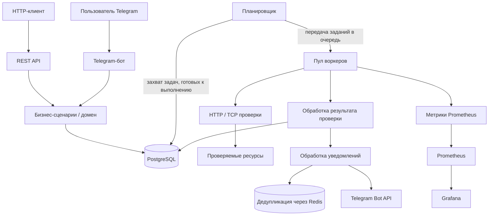

# Uptime Monitor

Backend-сервис на Go для мониторинга доступности HTTP- и TCP-эндпоинтов. Он выполняет проверки по расписанию, сохраняет время отклика и информацию о сбоях, отслеживает инциденты и отправляет уведомления через Telegram.

Это самостоятельно разработанный инженерный проект, посвящённый конкурентности в Go, фоновой обработке задач, PostgreSQL и наблюдаемости (observability).

> **Статус проекта:** локальная разработка / проект для портфолио. Текущая реализация не предназначена для развёртывания в публичном интернете или использования в production без дополнительных улучшений безопасности и надёжности.

## Возможности

- **HTTP-проверки:** сравнение HTTP-статуса ответа с ожидаемым значением и, при необходимости, проверка наличия текста в теле ответа.
- **TCP-проверки:** проверка возможности установить TCP-соединение с заданным адресом.
- **Выполнение по расписанию:** планировщик и пул воркеров с ограниченным параллелизмом позволяют выполнять проверки конкурентно.
- **Отслеживание инцидентов:** инцидент открывается после трёх последовательных неуспешных проверок и закрывается при восстановлении доступности ресурса.
- **Telegram-бот:** управление HTTP-мониторами и получение уведомлений DOWN / UP.
- **REST API:** создание, получение списка, просмотр, изменение и удаление мониторов; получение истории проверок и инцидентов.
- **Наблюдаемость:** экспорт метрик Prometheus, отображение их в Grafana и запись структурированных JSON-логов.
- **Хранение истории:** периодическое удаление старых записей о проверках (настроено хранение за 30 дней).

## Технологический стек

| Область | Технологии |
| --- | --- |
| Backend | Go 1.26, `net/http`, `chi` |
| База данных | PostgreSQL, `pgx` |
| Координация и дедупликация | Блокировки строк PostgreSQL, Redis |
| Уведомления | Telegram Bot API |
| Метрики и дашборды | Prometheus, Grafana |
| Миграции базы данных | Goose |
| Локальное окружение | Docker, Docker Compose |

## Архитектура

Проект организован как **модульный монолит**: HTTP API, Telegram-бот, планировщик и воркеры работают в одном Go-приложении и используют общие доменные модели и бизнес-сценарии (use cases).



**Особенности реализации:**

- Фиксированное количество горутин-воркеров получает задания из буферизированного Go-канала.
- Планировщик выбирает в PostgreSQL мониторы, для которых настало время проверки, с помощью `FOR UPDATE SKIP LOCKED` и обновляет время следующего запуска.
- HTTP-запросы и попытки TCP-подключения имеют таймауты, заданные для конкретного монитора.
- Сохранение результатов проверок и изменение состояний инцидентов выполняются отдельными бизнес-сценариями.
- Redis `SETNX` используется для временного захвата права на обработку уведомления, чтобы снизить вероятность дублирования; PostgreSQL также обеспечивает уникальность пары «инцидент / тип уведомления».

## Локальный запуск

### Требования

- Docker с поддержкой Docker Compose
- Токен Telegram-бота, созданного через [BotFather](https://t.me/BotFather)
- Go 1.26+ — только если нужно собирать проект или запускать тесты вне Docker

### 1. Настройка переменных окружения

Скопируйте предоставленный файл-пример и отредактируйте значения:

```bash
cp .env.example .env
```

Укажите `TELEGRAM_BOT_TOKEN` и выберите локальный пароль администратора Grafana в `.env`. Не добавляйте `.env` в коммиты и не передавайте реальные учётные данные другим людям.

В предоставленной конфигурации Docker Compose используются **учётные данные PostgreSQL, предназначенные только для разработки**. Перед использованием проекта вне доверенного локального окружения проверьте их и опубликованные порты.

### 2. Запуск приложения и зависимостей

```bash
docker compose up --build -d
```

Docker Compose запускает PostgreSQL, применяет миграции Goose, запускает Redis и Go-сервис, а затем Prometheus и Grafana.

Проверьте состояние контейнеров и логи:

```bash
docker compose ps
docker compose logs -f uptime-monitor
```

### 3. Проверка служебных эндпоинтов

```bash
curl http://localhost:8080/healthz
curl http://localhost:8080/readyz
```

Ожидаемые ответы при успешной проверке:

```json
{"status":"ok"}
```

```json
{"status":"ready"}
```

Эндпоинт готовности (readiness) проверяет соединение с PostgreSQL.

### Локальные сервисы

| Сервис | URL |
| --- | --- |
| REST API и служебные эндпоинты | `http://localhost:8080` |
| Метрики Prometheus | `http://localhost:8080/metrics` |
| Веб-интерфейс Prometheus | `http://localhost:9090` |
| Grafana | `http://localhost:3000` |

Для входа в Grafana используются учётные данные из `.env`. В репозитории находятся конфигурация автоматической настройки и дашборд Uptime Monitor в каталоге `monitoring/grafana/`.

Чтобы остановить контейнеры:

```bash
docker compose down
```

Эта команда сохраняет именованные тома базы данных и Grafana. Используйте `docker compose down -v` **только если намеренно хотите удалить локальные сохранённые данные**.

## Telegram-бот

После запуска контейнеров откройте своего Telegram-бота и отправьте `/start`. Команда зарегистрирует аккаунт Telegram в таблице `users` приложения.

Пример:

```text
/add https://example.com 60
/list
/status 1
/incidents 1
/pause 1
/resume 1
/remove 1
/help
```

Команда `/add` создаёт **HTTP-монитор**. Необязательный второй аргумент задаёт интервал проверки в секундах (по умолчанию — 60). TCP-мониторы можно создавать через REST API.

## REST API

Базовый URL: `http://localhost:8080`

| Метод | Эндпоинт | Назначение |
| --- | --- | --- |
| `POST` | `/api/v1/monitors` | Создать монитор |
| `GET` | `/api/v1/monitors?user_id=1` | Получить список мониторов пользователя |
| `GET` | `/api/v1/monitors/{id}` | Получить сведения, состояние, последнюю проверку и uptime |
| `PATCH` | `/api/v1/monitors/{id}` | Изменить настройки монитора |
| `DELETE` | `/api/v1/monitors/{id}` | Удалить монитор |
| `GET` | `/api/v1/monitors/{id}/checks?limit=50` | Получить последние проверки |
| `GET` | `/api/v1/monitors/{id}/incidents?limit=20` | Получить последние инциденты |

### Пример: создание HTTP-монитора

Сначала отправьте `/start` своему Telegram-боту. Чтобы узнать **внутренний идентификатор пользователя приложения** в локальной базе данных, выполните:

```bash
docker compose exec postgres psql -U postgres -d postgres -c 'SELECT id, telegram_id, username FROM users;'
```

Затем замените `1` в запросе ниже соответствующим значением `users.id`:

```bash
curl -X POST http://localhost:8080/api/v1/monitors \
  -H 'Content-Type: application/json' \
  -d '{
    "user_id": 1,
    "kind": "http",
    "address": "https://example.com",
    "interval_seconds": 30,
    "timeout_seconds": 5,
    "expected_status": 200,
    "expected_body": ""
  }'
```

Получите список мониторов или историю проверок созданного монитора:

```bash
curl 'http://localhost:8080/api/v1/monitors?user_id=1'
curl 'http://localhost:8080/api/v1/monitors/1/checks?limit=10'
```

Примеры HTTP-запросов для клиента также доступны в файле [`requests.http`](requests.http).

> **Примечание о безопасности:** REST API сейчас принимает идентификаторы пользователей без проверки аутентификации и прав владения ресурсами. Используйте его только в доверенном локальном окружении; в текущем виде API нельзя открывать для публичного доступа.

## Структура проекта

```text
cmd/monitor/              Точка входа приложения и связывание зависимостей
internal/
  checker/                Проверки доступности HTTP- и TCP-ресурсов
  domain/                 Основные сущности и их валидация
  metrics/                Метрики Prometheus и HTTP-эндпоинт
  notifier/               Отправка сообщений в Telegram
  redis/                  Дедупликация уведомлений
  repository/postgres/    Хранение данных в PostgreSQL
  scheduler/              Планирование проверок и очистка истории
  transport/rest/         Обработчики REST API
  transport/telegram/     Команды и меню Telegram-бота
  usecase/                Бизнес-логика и модульные тесты
  worker/                 Пул воркеров и очередь задач
migrations/               SQL-миграции Goose
monitoring/               Конфигурация Prometheus и Grafana
docs/                     Документ с требованиями к продукту
```

## Разработка и проверка

Из корня репозитория:

```bash
go test ./...
go test -race ./...
go vet ./...
go build -o /tmp/uptime-monitor-check ./cmd/monitor
```

Сейчас модульные тесты в основном сосредоточены на бизнес-сценариях (use cases). Отдельные интеграционные тесты PostgreSQL/Redis и тесты конкурентности для планировщика и пула воркеров — направления для дальнейшего улучшения. Успешный запуск с `-race` проверяет только тот код, который действительно выполняется существующими тестами.

## Текущие ограничения и следующие шаги

- **Безопасность API:** добавить аутентификацию и проверку прав владения ресурсами в REST-эндпоинтах.
- **Сетевая безопасность:** ограничить допустимые адреса мониторов и HTTP-перенаправления, чтобы снизить риск Server-Side Request Forgery (SSRF).
- **Надёжность уведомлений:** добавить устойчивые повторные попытки доставки уведомлений при недоступности Telegram.
- **Восстановление задач:** улучшить планирование, чтобы прерванные задания можно было повторно выполнять после сбоев процесса.
- **Проверки качества:** расширить интеграционные тесты и тесты конкурентности, добавить проверки в CI.

Более широкий план развития проекта приведён в [документе с требованиями к продукту](docs/PRD.md). **PRD описывает как запланированные, так и реализованные возможности; его нельзя считать списком уже завершённых функций.**
