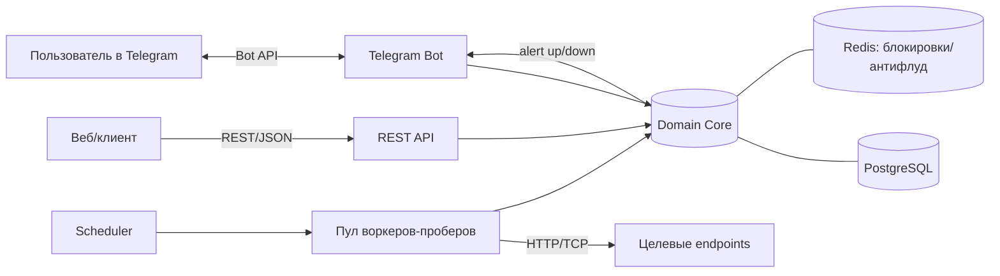
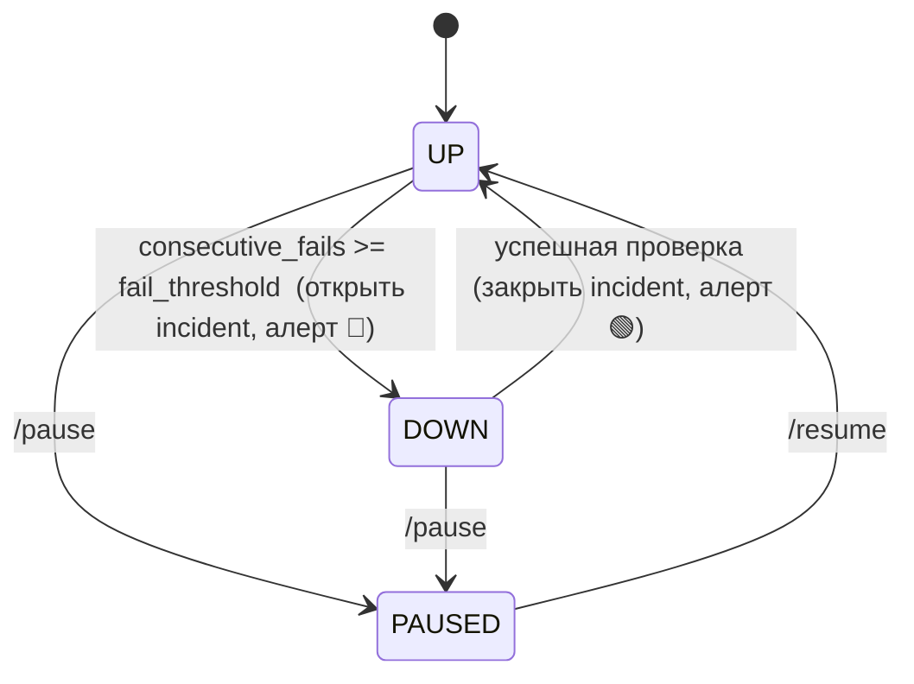

# PRD — Uptime Monitor (монитор доступности)

Сервис на Go, который периодически проверяет доступность сайтов/HTTP-эндпоинтов, считает uptime и время отклика, и шлёт алерты в Telegram при падении и восстановлении. Состоит из REST API, Telegram-бота и пула фоновых воркеров-проберов. Близко к реальным SRE/observability-задачам.

> [!info] Зачем проект
> Сильно «инженерный» проект: горутины и пул воркеров, планировщик, конкурентные HTTP-проверки, машина состояний инцидентов, метрики Prometheus, алертинг с антифлудом, graceful shutdown — ровно то, что ценят в бэкенд-вакансиях.

## 1. Цели и не-цели

**Цели:** следить за списком endpoints, фиксировать up/down и latency, считать uptime %, уведомлять о падении и восстановлении, хранить историю проверок и инцидентов.

**Не-цели:** полноценный APM/трейсинг чужих приложений; синтетические браузерные сценарии (только HTTP/TCP-проверки); многотенантный SaaS-биллинг.

## 2. Пользовательские сценарии

- Пользователь добавляет монитор: URL, интервал, таймаут, ожидаемый статус/строку в теле.
- Воркеры проверяют по расписанию; при N подряд неудачах открывается инцидент и приходит алерт «🔴 DOWN».
- При восстановлении инцидент закрывается, приходит «🟢 UP, недоступность длилась X».
- Пользователь смотрит статус всех мониторов, uptime % за период и историю инцидентов.

## 3. Архитектура



Подсистемы (API, бот, планировщик+воркеры) — горутины одного процесса с общим `context`, либо два бинаря (`api` и `prober`). Поддержка нескольких инстансов проберов через `SELECT ... FOR UPDATE SKIP LOCKED`.

## 4. Технологический стек

- Go 1.22+, `net/http` + `chi` для REST; `context` с таймаутами на каждую проверку.
- Telegram: `go-telegram-bot-api` / `telebot`.
- PostgreSQL (`pgx`) + миграции `goose`/`golang-migrate`.
- Redis (`go-redis`): распределённый лок проверки, дедуп/антифлуд алертов, кэш статусов.
- Планировщик + пул воркеров с ограничением конкурентности (worker pool + semaphore).
- Логи `slog` (JSON), метрики Prometheus, дашборд Grafana.
- Docker + docker-compose, k8s-манифесты (опц.), CI: golangci-lint + tests.

## 5. Типы проверок (адаптеры)

```go
type Checker interface {
    // выполняет проверку и возвращает результат
    Check(ctx context.Context, m Monitor) Result
    Kind() string // "http", "tcp", ...
}

type Result struct {
    Up         bool
    StatusCode int
    LatencyMS  int64
    Err        string
    CheckedAt  time.Time
}
```

- **HTTP(S):** код ответа в ожидаемом диапазоне, опц. поиск подстроки в теле, проверка SSL-срока действия сертификата.
- **TCP:** успешное установление соединения с host:port.
- Расширяемо: ping/ICMP, DNS (по желанию).

## 6. REST API

| Метод | Путь | Описание |
|---|---|---|
| POST | `/api/v1/monitors` | Создать монитор `{url, kind, interval, timeout, expected}` |
| GET | `/api/v1/monitors` | Список со сводным статусом |
| GET | `/api/v1/monitors/{id}` | Детали + текущий статус + uptime % |
| PATCH | `/api/v1/monitors/{id}` | Изменить параметры / пауза |
| DELETE | `/api/v1/monitors/{id}` | Удалить |
| GET | `/api/v1/monitors/{id}/checks` | История проверок (для графика latency) |
| GET | `/api/v1/monitors/{id}/incidents` | История инцидентов |
| GET | `/healthz` `/readyz` `/metrics` | Сервисные |

## 7. Команды Telegram-бота

- `/add <url> [интервал]` — добавить монитор.
- `/list` — список со статусами (🟢/🔴) и uptime %.
- `/status <id>` — детально: код, latency, аптайм за 24ч/7д.
- `/pause <id>` / `/resume <id>` — пауза/возобновление.
- `/remove <id>` — удалить.
- `/incidents <id>` — последние инциденты.
- `/help`, `/start`.

Push-алерты: `🔴 DOWN` при открытии инцидента, `🟢 UP` при восстановлении (с длительностью простоя).

## 8. Модель данных (PostgreSQL)

```sql
CREATE TABLE users (
    id         UUID PRIMARY KEY,
    tg_user_id BIGINT UNIQUE,
    created_at TIMESTAMPTZ NOT NULL DEFAULT now()
);

CREATE TABLE monitors (
    id            UUID PRIMARY KEY,
    user_id       UUID NOT NULL REFERENCES users(id),
    name          TEXT,
    kind          TEXT NOT NULL DEFAULT 'http',  -- http/tcp
    target        TEXT NOT NULL,                 -- url или host:port
    interval_sec  INT  NOT NULL DEFAULT 60,
    timeout_ms    INT  NOT NULL DEFAULT 5000,
    expected_code INT,                           -- напр. 200
    expected_body TEXT,                          -- подстрока (опц.)
    fail_threshold INT NOT NULL DEFAULT 3,       -- N неудач до инцидента
    status        TEXT NOT NULL DEFAULT 'unknown', -- up/down/unknown/paused
    consecutive_fails INT NOT NULL DEFAULT 0,
    next_check_at TIMESTAMPTZ NOT NULL DEFAULT now(),
    active        BOOLEAN NOT NULL DEFAULT TRUE,
    created_at    TIMESTAMPTZ NOT NULL DEFAULT now()
);
CREATE INDEX ix_monitors_due ON monitors(next_check_at) WHERE active;

CREATE TABLE checks (
    monitor_id  UUID NOT NULL REFERENCES monitors(id),
    up          BOOLEAN NOT NULL,
    status_code INT,
    latency_ms  BIGINT,
    error       TEXT,
    checked_at  TIMESTAMPTZ NOT NULL DEFAULT now(),
    PRIMARY KEY (monitor_id, checked_at)
);

CREATE TABLE incidents (
    id          UUID PRIMARY KEY,
    monitor_id  UUID NOT NULL REFERENCES monitors(id),
    started_at  TIMESTAMPTZ NOT NULL DEFAULT now(),
    resolved_at TIMESTAMPTZ,
    cause       TEXT
);
CREATE INDEX ix_incidents_open ON incidents(monitor_id) WHERE resolved_at IS NULL;
```

История `checks` может быстро расти — предусмотреть ретеншн (удаление старше N дней) или агрегацию в дневные сводки.

## 9. Машина состояний инцидента



Порог `fail_threshold` гасит «дребезг» (flapping) — алерт только после N подряд неудач, а не на каждый единичный сбой.

## 10. Логика фоновой проверки

1. Планировщик выбирает созревшие мониторы: `SELECT ... WHERE active AND next_check_at <= now() FOR UPDATE SKIP LOCKED LIMIT k`.
2. Пул воркеров с ограниченной конкурентностью выполняет `Checker.Check` с `context` по `timeout_ms`.
3. Результат пишется в `checks`, обновляется `latency`, `next_check_at = now() + interval`.
4. Обновление FSM: при неудаче `consecutive_fails++`; при `>= fail_threshold` и текущем статусе ≠ down — открыть инцидент и послать алерт. При успехе во время инцидента — закрыть инцидент, сбросить счётчик, послать «UP».
5. Антифлуд: повторные алерты подавляются (статус уже down); используем Redis для дедупликации между инстансами.

## 11. Нефункциональные требования

- **Точность статусов** важнее частоты алертов: антидребезг через `fail_threshold`.
- **Конкурентность/масштаб:** `SKIP LOCKED` + пул воркеров; несколько проберов без двойных проверок.
- **Изоляция таргетов:** таймауты, ограничение конкурентных проверок на один хост, отсутствие SSRF-рисков (валидация URL, запрет приватных адресов при необходимости).
- **Хранение:** ретеншн `checks`, индексы под выборки истории.
- **Graceful shutdown:** дождаться текущих проверок, корректно остановить бота и API.

## 12. Observability

- Метрики Prometheus: `monitors_total{status}`, проверок/сек, доля down, гистограмма latency по монитору, открытые инциденты, лаг планировщика.
- Дашборд Grafana: статус-плитки, графики latency и uptime %.
- Логи: `monitor_id`, результат, код, latency, переход FSM.

## 13. Тестирование

- Unit: FSM инцидентов, логика порога/антидребезга, парсинг ожидаемого ответа.
- Интеграционные (`testcontainers`: Postgres + Redis) + локальный тест-HTTP-сервер, эмулирующий 200/500/таймаут — проверить открытие/закрытие инцидента и алерты.
- Конкурентность: несколько воркеров не проверяют один монитор дважды (`SKIP LOCKED`).
- Бот: обработчики команд с мок Telegram API.

## 14. Этапы реализации

1. Модель данных + миграции + REST CRUD мониторов.
2. HTTP-checker + планировщик + пул воркеров + запись `checks`.
3. FSM инцидентов + антидребезг.
4. Telegram-бот (команды + алерты up/down).
5. TCP-checker, проверка SSL-срока (расширение).
6. Метрики + дашборд Grafana, ретеншн истории.
7. Docker Compose + CI + README с дашбордом.

## 15. Критерии готовности (DoD)

- [ ] CRUD мониторов через REST и бота
- [ ] HTTP- и TCP-проверки с таймаутами
- [ ] Планировщик с `SKIP LOCKED` и пулом воркеров
- [ ] FSM инцидентов с порогом (антидребезг)
- [ ] Алерты DOWN/UP в Telegram с антифлудом
- [ ] История проверок и инцидентов + uptime %
- [ ] Метрики Prometheus + дашборд Grafana
- [ ] Ретеншн истории, graceful shutdown
- [ ] Unit + интеграционные тесты
- [ ] Docker Compose + CI + README

---
Связанные: [[PRD - Price Tracker]] · обзор первого проекта [[00 - Обзор проекта]]
